# 01: Network Printer Won't Print

> **Ticket:** "I hit Print and it just says 'Waiting for printer connection,' then gives me an error."

**Device:** HP Color LaserJet Pro MFP 4301 (wireless network printer)
**Environment:** Windows 11 laptop on a home network

To reproduce this common ticket, I turned the printer off and sent a print job from Notepad.

## The Problem

Notepad hung on **"Waiting for printer connection..."**

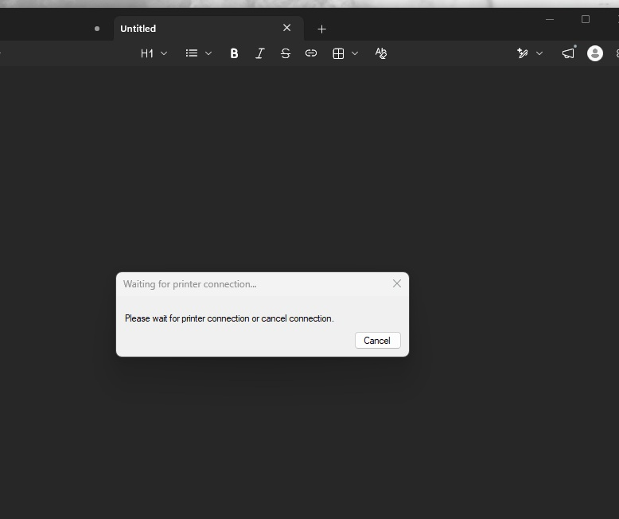

The print window then showed **"Your printer has experienced an unexpected configuration problem. 0x80004005."**

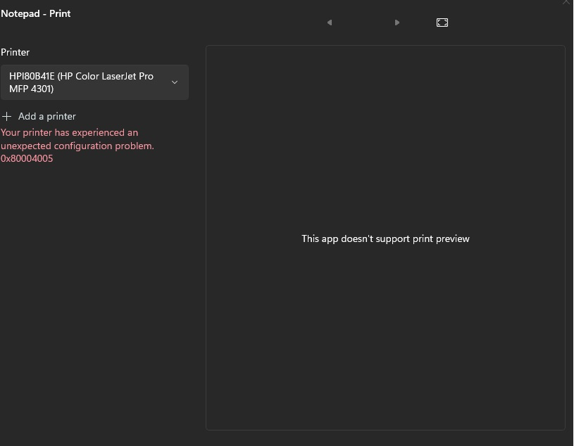

The print queue was empty, which meant the job never reached the spooler.

## Diagnosis and Fix

**1. Check the Print Spooler service**

Opened **Services**, then **Print Spooler**. The service was running.

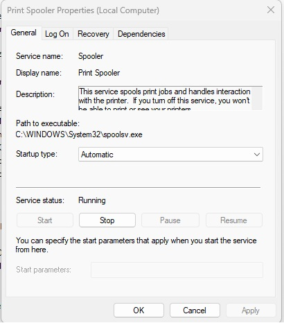

**2. Stop the spooler**

Stopped the service so any stuck print jobs could be cleared safely.

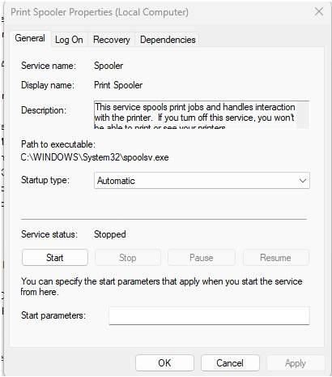

**3. Check for stuck print jobs**

Opened `C:\Windows\System32\spool\PRINTERS`, where Windows keeps queued jobs. It was empty, so stuck jobs weren't the cause.

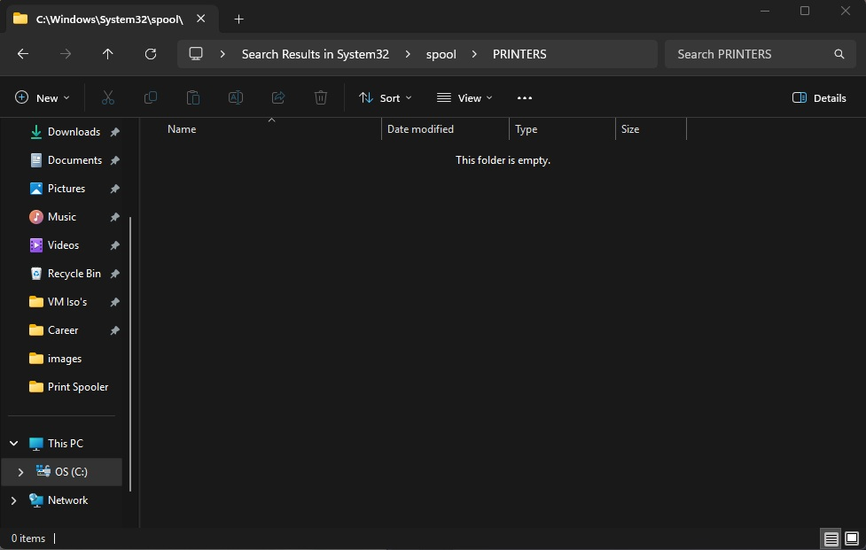

**4. Restart the spooler**

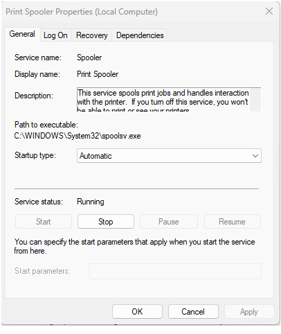

**5. Test it, and it still failed**

Turned the printer back on and printed a test page. It failed with **error 0x000003e3**, which means Windows started sending the job but the connection was cut off.

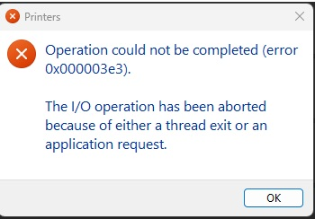

**6. Restart the spooler again**

The first restart happened while the printer was off, so I restarted it again with the printer on. The test page still failed, so the spooler wasn't the root cause.

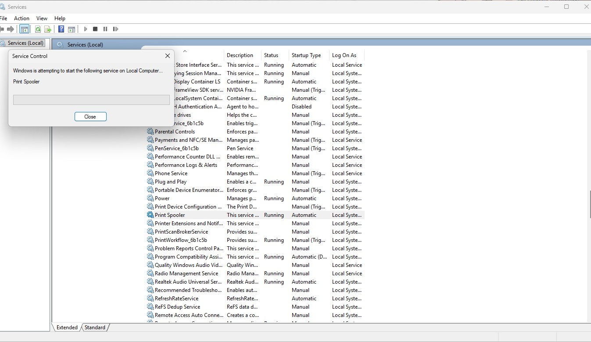

**7. Rule out the printer itself**

Printed a **Network Configuration Report** directly from the printer's control panel. It printed fine, so the printer hardware was working and the problem was between the laptop and the printer.

The report's top section covers **Wi-Fi Direct**, the printer's own separate network, with its own address. That address is **not** the printer's address on the home network, which is an easy thing to mix up while troubleshooting.

*Wi-Fi Direct password, MAC address, and related addresses are redacted.*

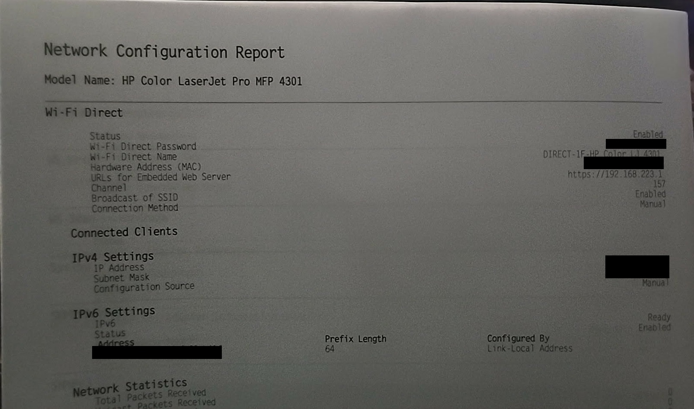

**8. Check the printer's network connection**

The printer's screen showed **Wi-Fi: Connected**. After the printer finished rejoining the network, Windows could reach it again.

## Verification

Sent a new test page. The job went into the queue and printed.

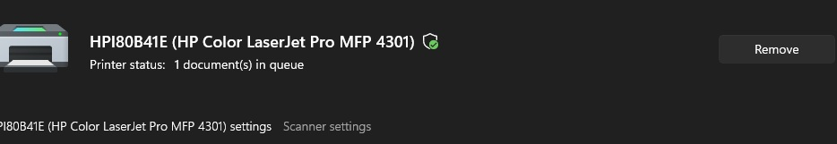

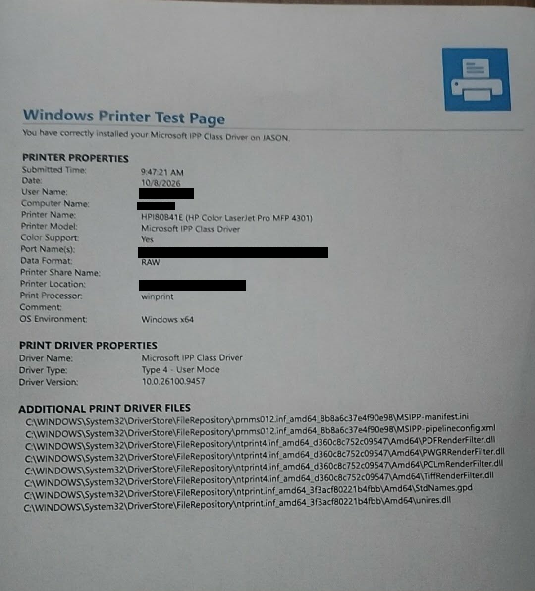

## Root Cause

The printer had been powered off and needed time to rejoin the Wi-Fi network. Restarting the Print Spooler cleared the Windows side, but the print could only succeed once the printer was back online.

## PowerShell Version

The same spooler reset in PowerShell, run as administrator:

```powershell
Stop-Service -Name Spooler -Force
Remove-Item "C:\Windows\System32\spool\PRINTERS\*" -Force
Start-Service -Name Spooler
Get-Service -Name Spooler
```

## Lessons Learned

- **A spooler restart isn't a cure-all.** It fixes stuck jobs, but it can't fix a printer that isn't on the network.
- **Isolate the problem.** Printing a report directly from the printer proved the hardware worked and narrowed the problem down to the connection.
- **Know which address you're looking at.** Wi-Fi Direct and the home network give the printer two different IP addresses.
- **Give network devices time.** A printer that was just powered on may need a few minutes to reconnect.
- **Protect sensitive details in documentation.** I redacted MAC addresses, passwords, and device identifiers before publishing.
